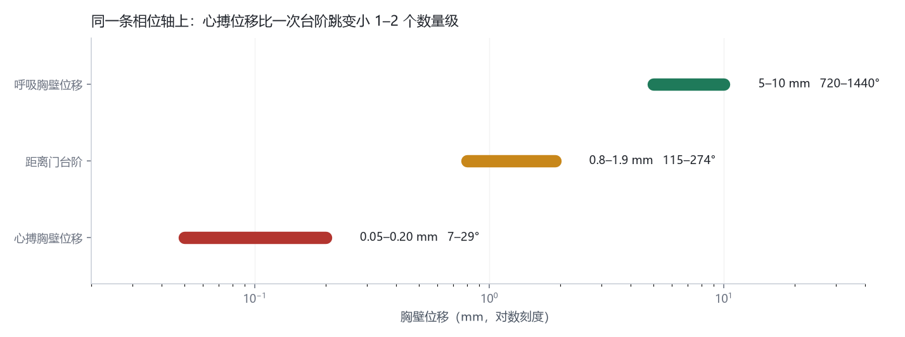
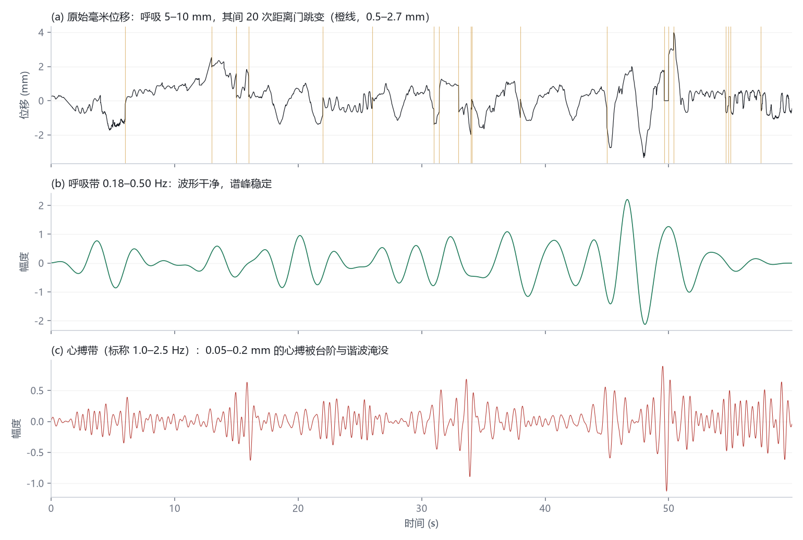
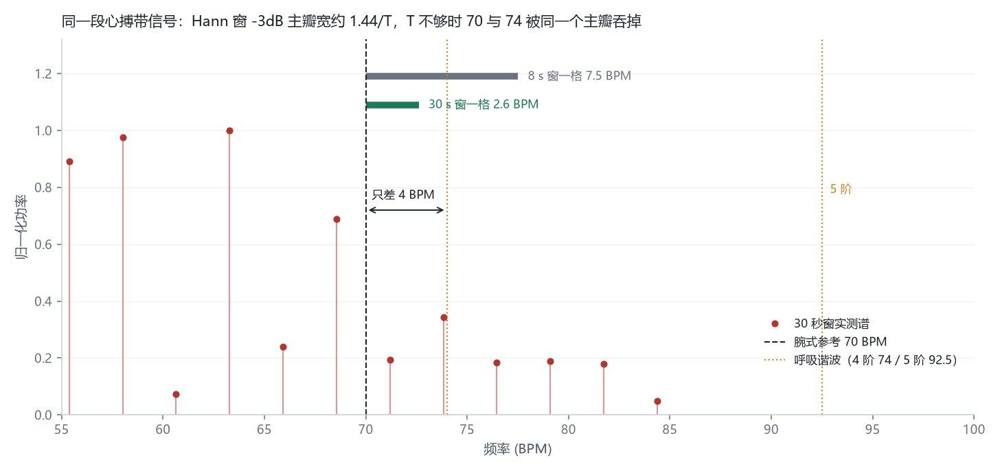
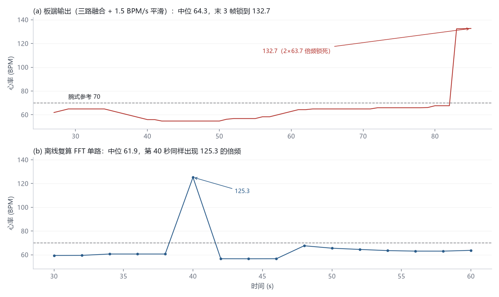

# 毫米波雷达测心率：0.05 毫米的信号，怎么证明它是心搏

> 60 GHz FMCW、90 Hz 采样、30 秒分析窗。不戴手环、不贴电极，人坐着不动，就能读出心率。
> 这篇文章不讲"雷达能测心率"这种结论，讲的是另一件事：**当心搏引起的胸壁位移只有 0.05–0.2 mm、相位只有 7–29 度时，你凭什么相信梳状谱里那根最高的线是心搏，而不是台阶、呼吸谐波或者它自己的二倍频。**
> 全部数字来自同一段 60 秒实测数据，配图和复算脚本都能跑。

## 0. 先给结论

| 项 | 数值 |
|---|---|
| 心搏引起的胸壁位移 | 0.05–0.20 mm，对应相位 7–29° |
| 呼吸引起的胸壁位移 | 5–10 mm，对应相位 720–1440° |
| 30 秒窗的谱分辨率 | 2.64 BPM |
| 板端输出（中位） | 64.3 BPM |
| 离线复算（两种口径） | 61.9 BPM（FFT 单路逐窗）／64.0 BPM（后 30 秒单窗） |
| 腕式参考 | 70 BPM |
| 与复算的偏差 | +0.3 BPM（同口径单窗）／+2.4 BPM（逐窗单路中位） |
| 与腕式参考的偏差 | −5.7 BPM |
| 主要失效 | 倍频锁死：末 3 帧 132.7 = 2 × 63.7 |

「与复算的偏差」和「与腕式参考的偏差」这两行是全文的重点：**"和复算差 0.3 BPM"和"测得准"是两件事**。前者只说明两套实现算的是同一个估计量，后者需要独立参考。这条链路目前能给出的诚实结论是：两种实现之间的差异在 0.3–2.4 BPM（取决于怎么比），而与腕式参考的系统偏差在 6 BPM 量级。

## 1. 先把量级摆出来

FMCW 雷达测的是相位，不是距离。目标径向位移 ΔR 与回波相位差的关系是

```
Δφ = 4π·ΔR / λ
```

RS6240 工作在 60 GHz，λ = c/f = 5 mm。代入得 1 mm 位移对应 144° 相位。于是三类位移落到同一条相位轴上：

| 来源 | 位移 | 相位 |
|---|---|---|
| 呼吸 | 5–10 mm | 720–1440°（跨 2–4 个整周） |
| 距离门跳变（典型） | 0.8–1.9 mm | 115–274° |
| 心搏 | 0.05–0.20 mm | 7–29° |



同一根轴上，心搏比呼吸小两个数量级，比一次台阶跳变小一到两个数量级。这不是"信噪比差一点"的问题，是**干扰项和被测量在同一个频带里，而且都比它大**。

那为什么还能测出来？因为心搏是准周期的。30 秒窗、90 Hz 采样，1.17 Hz 的心搏在频域里是一根谱线，噪声被摊到 1350 个频点上，单点对整带的处理增益约

```
10·lg(N/2) = 10·lg(1350) ≈ 31 dB
```

7–29° 的相位起伏，在 30 秒相干积累后足够浮出噪声底。**测心率的本质不是"测到 0.05 mm"，而是"用时间换幅度"**——这也直接决定了后面所有参数：窗必须长，长到能积累，长到能分辨。

## 2. 三个混叠源

### 2.1 台阶：相位基准自己跳了

雷达 cube 是 8 通道 × 30 距离门。取哪个距离门的相位，就等于选了哪个相位基准。人呼吸时胸廓位移 5–10 mm，回波能量会在相邻距离门之间移动，如果每帧都取能量最大的门，相位基准每换一次门就跳一次。

实测这段 60 秒数据里，幅度超过 0.5 mm 的跳变有 20 次，最大 2.71 mm：

```
跳变次数        20 次 / 60 s
跳变幅度        0.52 – 2.71 mm
污染区占比      26.1%（每次跳变前后各 0.5 s）
心率带平均能量   抬高 1.7 倍
```

把每次跳变前后各 0.5 秒记为污染区，占采样点的 26.1%，心率带平均能量因此抬高 1.7 倍——注意这是"平均"，在跳变发生的那一瞬间，瞬时能量远高于此。一个 2.71 mm 的跳变对应 390° 相位，是心搏的 13 倍以上，而且在频域上它是宽带的：跳变越陡，高频分量越多，正好铺满 1.0–2.5 Hz 这条心率带。



图 (c) 是 1.0–2.5 Hz 的心搏带。真正的心搏应该是稳定的准正弦，实际波形里那些尖锐的、成簇的鼓包，全部对应图 (a) 里的橙线位置。**你以为在找心搏，其实在给台阶做谱分析。**

### 2.2 呼吸谐波：正好落在心率带正中间

呼吸是周期信号，不是正弦。胸廓位移的波形越不对称，谐波越强。呼吸 18.5 次/分 = 0.308 Hz：

| 阶次 | 频率 | 换算 |
|---|---|---|
| 4 阶 | 1.233 Hz | 74.0 BPM |
| 5 阶 | 1.542 Hz | 92.5 BPM |

心率那条带，代码里写的是 1.0–2.5 Hz，但按 90 Hz 下的 SOS 系数算实际响应，−3dB 通带是 0.90–2.25 Hz，也就是 54–135 BPM；峰值搜索范围则放到 40–180 BPM，把滤波器的裙边和低心率也纳进来。4 阶、5 阶谐波正好落在这条带里，而呼吸位移是毫米级、心搏是 0.05 mm 级——**谐波的能量天然比心搏大**。

这段数据里，4 阶谐波归一化功率 0.34，心搏峰 1.00，看起来"心搏赢了"。但这是这一段的运气：换个呼吸深度、换个坐姿，比例就会翻转。早前另一段数据里，带内最强峰稳定出现在 76–80 BPM，比板端输出高 16 BPM，最后发现那个"参考值"根本就是 4 阶谐波。

结论很硬：**"取带内最强峰"这个规则本身是错的**。谁强听谁的，等于把判据交给了干扰项。

### 2.3 倍频：三路同时锁到二倍频

第三个混叠源最隐蔽，因为它在时域上看起来"非常合理"。

板端输出的最后 3 帧是 132.4、132.5、132.7，而同一时段离线复算的 FFT 峰在 63.7。132.7 / 63.7 = 2.08。这不是随机尖峰，是**倍频锁死**：机理通常是基频被台阶压得足够低、而二次谐波因波形不对称占了上风，这时 FFT、自相关、峰值间期三条路径会同时选中二倍频。

离线复算里也有一次：第 40 秒的窗给出 125.3，前后窗都是 56–63。陷波把它压到 117.3，但没消掉——因为陷波挖的是呼吸谐波，而这里是心搏自己的二次谐波。

## 3. 分辨率预算：为什么必须是 30 秒

2.2 的解法听起来简单：把心搏和 4 阶谐波分开就行了。问题是"分开"需要多长的窗？

心搏 70 BPM = 1.167 Hz，4 阶谐波 74 BPM = 1.233 Hz，间隔

```
Δf = 0.0667 Hz = 4 BPM
```

Hann 窗的 −3dB 主瓣宽约 1.44/T（T 为窗长）。要分开两个等幅峰，主瓣不能宽过它们的间隔：

```
1.44 / T < Δf   →   T > 21.6 s
```

所以 30 秒不是调出来的，是这条约束下限之上的取值：留 1.4 倍余量，对应谱格

```
Δf_bin = fs / nperseg = 90 / 2048 = 0.044 Hz = 2.64 BPM
```

一格 2.64 BPM，两个相隔 4 BPM 的峰之间还能站下一格。而早期版本用 8 秒窗，谱格 7.5 BPM、−3dB 主瓣宽 10.8 BPM，是间隔的 2.7 倍——70 和 74 被同一个主瓣整个吞掉，再怎么找峰都是掷硬币。



这张图把两把尺子画在一起：8 秒窗一格 7.5 BPM，比要分辨的 4 BPM 还宽；30 秒窗一格 2.6 BPM，两个峰之间还留得下间隙。代价是响应变慢：呼吸率或心率真变了，要 30 秒才能完全反映。对静坐监测可以接受，对运动场景不行。

## 4. 判据链：四道闸

量级和分辨率定完，剩下的问题是"怎么让判据成立"。板端是一条四闸链，每一闸都在处理上一步的残差。

```
SPI cube (8ch × 30 gate, 90 Hz)
 └─ 距离维 FFT + 杂波抑制
     └─ ① 距离门打分 + 滞后锁定      ← 冻结相位基准
         └─ 多通道复数融合 → 相位 → mm
             └─ ② 呼吸：0.18–0.50 Hz / 30 s Welch
                 └─ ③ 谐波陷波（依赖 ②）+ FFT/HPS、ACF、PPI 三路
                     └─ ④ 加权融合 + 1.5 BPM/s 平滑 + 重锁
```

### ① 距离锁定：先保证基准不动

每个距离门按能量、相位稳定性、跨通道一致性打分，只有当候选门连续多帧胜出、且领先优势足够大时才切换，跳门额外惩罚。这一步不提高灵敏度，它做的是**给相位一个稳定的基准**——没有它，跳门从"每帧都可能"变成"每秒几十次"；有了它，剩下的是这段数据里 20 次/60 秒的残差，也就是下面那个 26%。

### ② 呼吸先估准，否则后面全错

呼吸用 30 秒窗 Welch（nperseg = 2048，Hann，50% 重叠），频带 0.18–0.50 Hz，峰值/带内中位数 ≥ 1.8 才输出。下边界为什么是 0.18 而不是 0.14：0.14 Hz（8.4 次/分）会把基线漂移纳进来，30 秒窗里出现 10.5 和 18.5 两个等强峰，输出在两者之间反复跳（倍频程误判）。抬到 0.18 Hz 后漂移被排除。**注意改的是峰值搜索区间，不是滤波器**。

### ③ 陷波：在 3.6 BPM 的半宽里走钢丝

`aura_rhc_notch()` 在频域把 k·f_resp 处挖掉 ±0.06 Hz。±0.06 Hz 就是 ±3.6 BPM，而心搏与 4 阶谐波只差 4 BPM——**陷波的半宽和需要保护的间隔是同一个量级**。挖宽一点，心搏被削；挖窄一点，谐波残留。

所以有两条保护规则：

- 40–60 BPM 的谐波不挖。这一段本身就是低心率区，挖掉的风险大于收益。
- 挖之前先取带内 3 个最强谱峰 + 1 个自相关主峰作候选，某个谐波落在候选 6 BPM 以内就跳过。

第二条是这套设计里最"工程"的一处：它承认陷波器无法自己判断"这是谐波还是心搏"，于是把判断权交给多路估计的一致性。

但陷波有个死穴：**它的位置完全由 f_resp 决定**。呼吸估偏 10%，18.5 → 20.35 次/分，4 阶谐波从 74 挪到 81.4，偏了 7.4 BPM，接近 3 个谱格。这时候按 74 挖，等于在错误的位置挖了个洞，真正的心搏反而被削掉一角。这也是为什么第 ② 步必须先做稳。

### ④ 三路融合：让三个独立判据互相作证

| 路径 | 方法 | 强项 | 弱项 |
|---|---|---|---|
| FFT | Welch + 6 阶谐波积谱 | 抗噪、分辨率高 | 容易被谐波带偏 |
| ACF | 自相关主峰 + 边缘惩罚 | 对周期性稳 | 分辨率受采样限制 |
| PPI | 峰值间期（事件/模板/寻峰） | 直接对应生理间期 | 搏动少时漏拍 |

权重不是平均，而是按各自的可靠度缩放：

```
w_fft = clip(snr / 5, 0.1, 1.0)
w_acf = clip(acf_height, 0.1, 1.0)
w_ppi = clip((n_peaks - 4) / 12, 0.05, 1.0)
```

PPI 的权重直接跟搏动数挂钩：10 秒窗里只有 8–10 个搏动，漏一拍间期就翻倍，所以搏动少时把 PPI 压到 0.05–0.5。

融合规则三条：三路最大差 < 8 BPM 取加权平均；FFT 与 ACF 相差 ≤ 10 BPM 而 PPI 离群，丢弃 PPI；其余取中位数。**规则的设计目标不是"更准"，是"任一路被带偏时不跟着错"。**

最后一级是速率平滑：每次更新最多变 1.5 BPM/s，置信度低于 0.30 不接受，连续 3 帧一致且与当前值差 15 BPM 以上才允许重锁。它在抗尖峰和跟得上变化之间取了个折中——也正是倍频锁死的入口：连续 3 帧二倍频一致，它就认了，132.7 就是这么来的。

## 5. 实测：一致不等于准确

测试条件：RDK X5 + RS6240，CH347 转 SPI，板端 C++ 以 90 Hz 连续出帧；受试者静坐于雷达正前方 0.6–1.2 m，全程无体动；另记一次腕式读数 70 BPM 作为外部参考。



| 序列 | 中位 | 范围 | 说明 |
|---|---|---|---|
| 板端输出 | 64.3 | 54.7–132.7 | 59 有效帧，前 27 秒预热无输出 |
| 离线 FFT 单路 | 61.9 | 56.6–125.3 | 16 个窗，窗长 30 s，步进 2 s |
| 后 30 秒单窗复算 | 64.0 | — | 官方 compare_export 的参考值 |
| 腕式参考 | 70 | — | 单点读数 |

官方复算脚本打印的是 `心率偏差 +0.3 BPM`。这个数字很漂亮，但它证明的事情比看上去少得多：

**64.0 和 64.3 都是"对同一段信号做带通 + 谱峰搜索"的结果。** 两者参数一一对应，代码同源，差异只来自因果滤波与零相位滤波的相位响应、窗的边界。它们一致，只说明实现没写错，不说明这个峰是心搏。

真正的独立参考只有腕式读数 70。按它算，系统偏差是 −5.7 BPM（板端）／−6.0 BPM（复算）。这个偏差有两个候选解释，我倾向第一个，但没有证据排除第二个：

1. **主瓣被低频侧的能量拖偏。** 台阶是宽带的，且跳变谱按 1/f 衰减，心率带里低端（55–65 BPM）的干扰能量天然比高端大，谱峰被不对称地拉向低端。证据是陷波前后峰值都停在 63.3，而 4 阶谐波 74 的功率只有它的三分之一——说明主峰不是谐波，是被"拽"过来的。
2. **参考时刻与窗不对齐。** 腕式读数是单点，30 秒窗是平均，如果被测者在这半分钟里心率本身在降，两者本来就不该相等。

**要判定这件事，需要同步 ECG 或指夹式 PPG，而不是一块手表的一次读数。** 这是这套系统目前最欠的一环，也是我不打算把它写成"精度 ±1 BPM"的原因。

## 6. 误差预算

| 环节 | 量化 | 性质 |
|---|---|---|
| 相位灵敏度 | 7–29° / 0.05–0.20 mm | 物理下限 |
| 距离门台阶 | 20 次/分，覆盖 26%，带内能量 ×1.7 | 主要干扰 |
| 呼吸谐波 | 74.0 / 92.5 BPM，与心搏隔 4 BPM | 主要干扰 |
| 谱分辨率 | 2.64 BPM（30 s，nperseg 2048） | 量化误差 |
| 陷波半宽 | ±3.6 BPM，与保护间隔同量级 | 结构性风险 |
| 三路融合 | 差异 > 8 BPM 才分歧处理 | 一致性约束 |
| 速率平滑 | 1.5 BPM/s，重锁 15 BPM / 3 帧 | 跟踪滞后 |
| 实测一致性 | 0.3 BPM（单窗）／2.4 BPM（逐窗中位） | 实现差异，非随机误差 |
| 与腕式参考 | −6 BPM 量级 | 系统偏差，待独立参考确认 |

## 7. 失效模式

| 现象 | 机理 | 现状 |
|---|---|---|
| 心率稳定偏低 8–15 BPM | 谱峰是呼吸 4/5 阶谐波 | 靠陷波 + 候选保护，依赖 f_resp 准确 |
| 心率偶发 125–133 | 三路同时锁二倍频，重锁机制接受 | **未解决**，只能靠 motion 标记提示 |
| 体动后短暂失锁 | 台阶密集，相位基准反复切换 | 部分靠距离锁定缓解 |
| 启动后读数缓慢爬升 | 平滑器被坏初值播种 | 已修：分析窗 < 20 s 不喂平滑器 |
| 呼吸在 10.5 / 18.5 之间跳 | 频带下边界含基线漂移 | 已修：0.18 Hz |

第 2 条是当前最大的洞。陷波对它无效（125.3 只降到 117.3），平滑器反而是帮凶。正确的做法应该在相位解缠层：检测 2π 整数倍跳变并补偿，让台阶在进入频谱之前就消失，而不是在频域里硬扛。这条我还没做出来——难点是在不整段解缠的前提下保证鲁棒。

## 8. 复现

```bash
pip install numpy scipy
cd aura/tools/verify

# 参考值 vs 板端输出（本文第 5 节那张表）
python compare_export.py --phase phase7.csv --snap snap7.csv

# 逐窗复现板端 FFT 单路（图 4 下半）
python replay_board_hr.py --phase phase7.csv --snap snap7.csv --window 30

# 换不同下边界重跑呼吸估计（复现 0.14 → 0.18 的跳变）
python spectrum_check.py --phase phase7.csv --lo 0.14 --hi 0.50
```

配图脚本是仓库根目录的 `_make_hr_post_figs.py`，四张图全部从 `phase7.csv` / `snap7.csv` 现场算，没有手画数据。原始数据涉及个人体征，不随仓库发布；没有数据时脚本只做算法自检。

仓库：https://github.com/OKX879/aura （MIT）

## 9. 边界

- 只验证了 0.6–1.2 m、正面坐姿、单人、静息这一个场景。多人、侧身、边走边测都没验证。
- 90 Hz 采样、30 秒窗，这套参数天生不适合逐拍分析（HRV）和运动场景；要覆盖这些，采样策略和窗长得重做，不是调参能解决的。
- **不是医疗器械。** 所有读数只能当趋势参考，不能用于诊断。

如果只让我留一句话：**这套系统的难点从来不是"测到 0.05 毫米"，而是"在能量比它大两个数量级的干扰里，建立一条能被证伪的判据"。** 判据链越清晰，失效模式就越可解释——132.7 那个尖峰之所以不可怕，是因为它一眼就能被认出是 2 × 63.7；真正危险的是那些"看起来完全合理"的 60 和 18.5。
