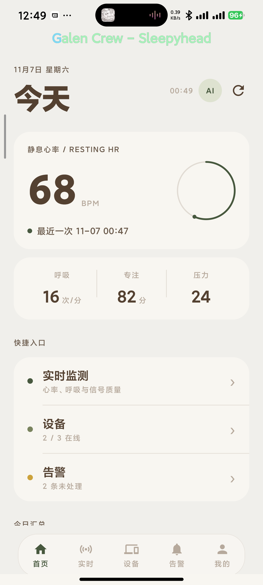
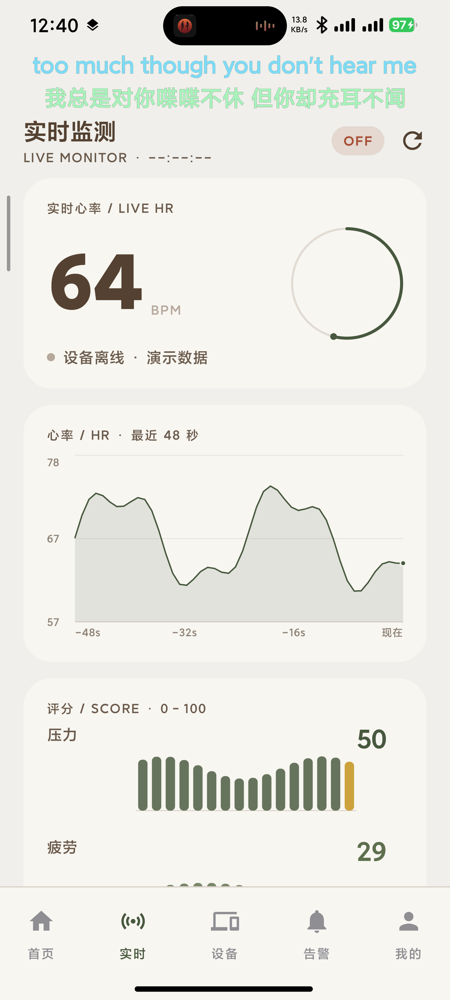

# AURA：用一块 60GHz 毫米波雷达做非接触体征监测，完整开源

不戴手环、不贴电极、不采集画面。人往设备前面一坐，屏幕上就能看到心率、呼吸和当前状态。

这是我做了几个月的桌面设备 AURA，现在以 MIT 协议完整开源：板端 C++ 服务、便携 C 算法库、雷达驱动、Android App、部署脚本和离线验证工具，全部在仓库里。

## 项目信息

| 项目 | 说明 |
|---|---|
| 定位 | 非接触式心率 / 呼吸 / 体动监测 |
| 主控 | RDK X5（aarch64，Ubuntu 22.04） |
| 雷达 | RS6240，57–66 GHz，8 通道 × 30 距离门 |
| 转接 | CH347，USB 转 SPI + UART |
| 板端 | C++20 + Drogon + SQLite |
| App | Kotlin + Jetpack Compose |
| 采样 | 90 Hz，10.24 秒滑窗，1 秒更新 |
| 协议 | MIT |

## 为什么做这个

手环和手表最大的问题是"要戴着"。洗澡要摘、睡觉可能忘、长期佩戴皮肤不舒服。而很多场景并不需要 24 小时连续监测，只想知道"此刻坐在这里的人状态怎么样"。

毫米波雷达的好处是真正的非接触：不拍图像、不采集画面，只测胸廓的微小位移。相比摄像头，隐私上更容易被接受；相比穿戴设备，没有任何佩戴负担。

难点也很直接：

- 呼吸引起的胸壁位移是毫米级
- 心搏只有 0.05–0.2 mm
- 人稍微动一下，幅度就比这个大一个数量级

所以这个项目的大部分工作量不在"怎么采数据"，而在"怎么把体征从噪声里抠出来"。下面会讲清楚整条链路。

## 能做什么

### 设备侧

| 能力 | 说明 |
|---|---|
| 呼吸率 | 30 秒滑窗 Welch，0.18–0.50 Hz，输出保留 0.1 次/分 |
| 心率 | 1.0–2.5 Hz 带通，FFT/HPS、自相关、峰值间期三路融合 |
| 体动检测 | 快速体动识别，体动时自动降低置信度 |
| 信号质量 | 距离门打分、跨通道一致性、SNR 门限 |
| 设备心跳 | 帧计数停止增长自动转离线，写入 `last_seen_at` |
| 局域网发现 | UDP 37020，收到探测回复设备信息 |
| 数据存储 | SQLite WAL，设备 / 告警 / 体征记录 / 设置 |
| 鉴权 | bcrypt 密码、Bearer Token、6 位配对码 |

### App 侧

| 页面 | 内容 |
|---|---|
| 首页 | 静息心率、呼吸、专注度、压力、设备在线数、未处理告警 |
| 实时 | 当前心率、48 秒滚动曲线、评分、信号状态 |
| 趋势 | 按天的体征变化 |
| 设备 | 配对码添加、局域网扫描、在线状态、固件版本 |
| 告警 | 心率异常、设备离线、数据中断、无人值守，可逐条删除 |
| 我的 | 昵称、头像、语言切换、背景壁纸、AI 助手配置 |

其它细节：中英双语、5 套内置壁纸 + 相册背景、AI 助手支持任意 OpenAI 兼容接口（DeepSeek / OpenAI / 通义千问 / 本地 Ollama）。

<p align="center">
  
  
</p>

> 截图是开发阶段的演示数据，不是实际测量结果。

## 系统架构

```
┌──────────────┐   SPI 8 MHz   ┌──────────────┐
│  RS6240 雷达  │◄─────────────►│ CH347 USB-SPI │
│ 57–66 GHz    │   UART 115200 │   转接板       │
└──────────────┘               └───────┬───────┘
                                       │ USB
                               ┌───────▼─────────┐
                               │  RDK X5 (aarch64) │
                               │  Ubuntu 22.04     │
                               │                   │
                               │  AuraService      │
                               │  ├─ radar_live     │  SPI 采帧、HIF 唤醒
                               │  ├─ libaura        │  距离门 / 相位 / 体征
                               │  ├─ Drogon HTTP    │  REST + 鉴权
                               │  └─ SQLite WAL     │  设备 / 告警 / 趋势
                               └───────┬───────────┘
                                       │ HTTP / UDP 发现
                               ┌───────▼───────────┐
                               │ Android App        │
                               │ Kotlin + Compose   │
                               └───────────────────┘
```

### 模块职责

| 目录 | 职责 |
|---|---|
| `radar/` | SPI 读写、HIF 唤醒、cube 解析、ROI 配置，纯 C，不依赖框架 |
| `algorithm/` | 距离门打分、空间融合、相位提取、呼吸/心率、体动、事件，纯 C，无硬件依赖 |
| `service/` | Drogon HTTP、鉴权、SQLite、设备心跳、局域网发现 |
| `android/` | 展示、配对、设备管理、告警、趋势、AI 助手 |

算法库刻意做成无硬件依赖：在普通 Linux 上 `make` 就能编译，方便离线验证和二次开发。

## 信号处理链路

```
SPI 复数立方体 (8 通道 × 30 距离门, 90 Hz)
  └─ 距离维 FFT + 杂波抑制
      └─ 距离门打分 + 滞后锁定
          └─ 多通道复数融合 → 相位
              └─ 相位转毫米位移
                  ├─ 0.18–0.50 Hz → 30 秒 Welch → 呼吸
                  └─ 1.0–2.5 Hz 带通 → 30 秒窗
                       ├─ FFT + 谐波积谱
                       ├─ 自相关
                       └─ 峰值间期
                           └─ 三路加权融合 → 1.5 BPM/s 平滑
```

每一步都在解决一个具体问题：

**距离门锁定。** 呼吸时胸廓位移有 5–10 mm，足以让回波能量在相邻距离门之间移动。如果每帧都取能量最大的门，相位会出现 1–2 mm 阶跃，频谱上就是一片宽带噪声。项目用打分 + 滞后锁定 + 跳门惩罚把门稳住。

**呼吸用 30 秒窗。** 8 秒窗的频率分辨率只有 7.5 次/分，和呼吸周期本身一个量级。改成 30 秒 Welch 后分辨率 2.6 次/分，输出才稳。

**呼吸频带下边界 0.18 Hz。** 更低的频段会把基线漂移当成呼吸，输出会在 10 和 18 次/分之间反复跳。

**心率先估呼吸，再做陷波。** 呼吸 18.5 次/分时，它的 4 次谐波正好是 74 BPM，落在心率搜索带里，能量比真实心搏还大。必须先用呼吸频率挖掉各阶谐波，再找心搏。

**三路融合按搏动数加权。** 10 秒窗只有 8–10 个搏动，漏一拍峰值间期就翻倍。所以 PPI 的权重直接跟搏动数挂钩，三路不一致且 PPI 离群时直接丢弃。

**预热闸门。** 分析窗不足 20 秒时不喂速率平滑器。否则用前几秒的坏值播种，要一分多钟才能爬回真值。

这些坑的完整复盘在另一篇技术文章里，仓库 `docs/blog-technical.md` 也有。

## 分层设计：为什么不是"滤波加找峰"

很多雷达测体征的 Demo 只有三步：带通、FFT、取最大峰。这条链路能出数，但出不了稳定的数。AURA 把它拆成五层，每一层都有明确的输入、输出和失败处理。

### 第一层：空间层，每个距离门算十几项指标

不是选能量最大的门。每个距离门会计算：

- 能量与幅度稳定性
- 相位有效率
- 通道间相干性
- 周期性
- 相位跳变率
- 体动分数
- 深度凹陷比例
- 谱 SNR

综合成一个质量分再排序。能量最大的门经常是墙面反射或者强干扰，相位很脏；质量分能把这种门排下去。

### 第二层：轨迹层，Viterbi 全局最优 + 滞后锁定

单帧选门会抖，所以还要在时间轴上约束：

- 用 Viterbi 在整段窗口上求全局最优的距离门轨迹，代价函数包含跳门惩罚和轨迹平滑项，避免逐帧贪心
- 在线部分用滞后锁定：质量门限、切换余量、邻门确认、跳门确认、丢失保持，五个参数控制"什么时候允许换门"
- 锁定状态是**亚 bin 的**（`continuous_bin` 是浮点），用相邻门的能量做插值，突破 30 个离散距离门的粒度
- 完整状态机：跟踪 / 保持 / 丢失 / 捕获 / 重获，每帧输出置信度

这一步决定了相位序列连不连续。相位一断，后面所有频域分析都是白算。

### 第三层：融合层，复数域相干融合

多通道不是简单相加：

- 先把各通道相位对齐，再按相干性加权
- 距离维用高斯核在邻域内加权，避免单门噪声
- 相干性低于门限的通道和距离门直接剔除
- 融合结果带可靠位掩码，后续算法知道哪些点可信
- 单独的相位跳变修复：设置跳变阈值和累积阈值，检测到异常时冻结相位若干帧，等信号恢复

输出是连续的毫米位移 + 每点可靠标记，而不是一条"看起来还行"的曲线。

### 第四层：生理层，呼吸和心率互相约束

这是最容易出错的一层，因为两个信号在频域上会打架：

- 呼吸：30 秒 Welch，SNR 门限，抛物线插值，失败时最多保持 8 帧
- 心率：先用呼吸基频做 RHC 陷波，挖掉各阶谐波，再跑三路估计
- 三路是异构的：FFT/HPS 看频域，自相关看时域周期，峰值间期看逐拍间期
- 权重不是固定的：FFT 按谱 SNR，ACF 按峰高，PPI 按搏动数
- 一致性判别：三路差小于 8 BPM 才加权平均，否则按"FFT 与 ACF 吻合、PPI 离群"的规则剔除
- 2:1 倍频救援：高心率下 PPI 漏拍、ACF 取到倍周期时，用 FFT 拉回来
- 速率平滑器带种子池和重锁池，防止初值污染，也允许真实心率变化时重新锁定

### 第五层：时序层，事件与 HRV

- 事件检测输出逐拍时间、幅度、IBI 序列和分段
- HRV 计算 RMSSD、SDRR、pNN50，同时给出覆盖率、有效间期数和数据充足性判定
- 数据不够时明确返回原因，而不是硬算一个数

### 贯穿全链路的可验证性

这套链路有一个别的项目经常忽略的设计：**关键中间结果都能导出、能复现**。

- 逐样本毫米位移导出成 CSV
- 逐帧算法输出（心率、呼吸、置信度、体动）导出成 CSV
- 电脑上用 scipy 从零复现整条链路，逐秒对齐

没有这一层，前面所有"先进"都无法证明。这也是我能定位到"心率峰其实是呼吸谐波"的原因。

### 工程约束

- 纯 C11，无第三方依赖，算法确定性可复现
- 90 Hz 实时处理，在 RDK X5 的 aarch64 上稳定运行
- 支持离线 cube 回放（`AURA_LIVE_CUBE`），方便复现和回归测试
- 算法库和硬件解耦，PC 上 `make` 就能编译

## 实测验证

验证不是看曲线漂不漂亮，而是把原始毫米位移导出成 CSV，用 scipy 从零复现整条链路，再逐秒对比。

同一段 60 秒原始数据：

| 指标 | 板端输出（中位） | 离线复算 | 偏差 |
|---|---|---|---|
| 心率 | 64.3 BPM | 64.0 BPM | +0.3 BPM |
| 呼吸 | 18.4 次/分 | 18.5 次/分 | −0.0 次/分 |

验证过程中还发现过一个反直觉的问题：直接用"1.0–2.5 Hz 带内最强峰"当参考，会得到 76–80 BPM，看起来板端偏低 20。实际上那个峰是呼吸的第 4、5 次谐波，真值是 70。**先确认呼吸估对了，心率参考才有意义。**

导出开关只在设置环境变量时生效，正常运行零开销：

| 环境变量 | 内容 |
|---|---|
| `AURA_PHASE_DUMP` | 逐样本毫米位移 `n,mm` |
| `AURA_SNAP_DUMP` | 逐帧输出 `frame,hr,resp_hz,conf,motion` |

`tools/verify/` 里是三个复算脚本：参考值对比、板端 FFT 路逐条复现、呼吸频带与谐波诊断。

## 部署

### 前置条件

RDK X5 需要先编译安装 CH347 内核模块 `ch34x_mphsi_master`，否则不会出现 `/dev/spidev8.0`。这一步是最容易漏的，官方镜像不自带。

### 编译

```bash
# 算法库，无硬件依赖
make -C algorithm

# 板端服务，需要 Drogon、OpenSSL、sqlite3
cmake -S service -B service/build -DCMAKE_BUILD_TYPE=Release
cmake --build service/build -j
```

### 安装

```bash
sudo mkdir -p /opt/aura/app/data
sudo install -m 755 service/build/AuraService /opt/aura/app/
sudo install -m 755 deploy/aura-ch347-setup.sh /usr/local/bin/
sudo cp deploy/aura.service deploy/aura-ch347.service /etc/systemd/system/
sudo cp deploy/99-aura-ch347.rules /etc/udev/rules.d/
sudo cp deploy/99-aura-ch34x.conf /etc/modprobe.d/
sudo udevadm control --reload-rules && sudo systemctl daemon-reload
sudo systemctl enable --now aura-ch347.service aura.service
```

### 验证

```bash
curl -s http://127.0.0.1:3000/api/v1/health
```

要看三个字段：`radar_running: true`、`radar_frames` 持续增长、`radar_stalled_ms: 0`。

完整的逐步部署、设备节点确认、App 连接和排障表在 `docs/deploy.md`。

## 公网访问

板卡在局域网里，App 出门就连不上。项目支持几种做法：

| 方式 | 公网可见 | 需要域名 | 说明 |
|---|---|---|---|
| Tailscale Serve | 否，仅自己的设备 | 不需要 | 最安全，推荐 |
| Tailscale Funnel | 是 | 不需要 | 自动 HTTPS，本项目实测方案 |
| Cloudflare Tunnel | 是 | 需要 | 可用自定义域名和访问控制 |
| frp + VPS | 是 | 需要 | 完全自控 |

最省事的是 Tailscale：

```bash
curl -fsSL https://tailscale.com/install.sh | sh
sudo tailscale up

sudo tailscale serve --bg 3000     # 只有 tailnet 内设备能访问
# 或
sudo tailscale funnel --bg 3000    # 公网可见，自动带 HTTPS
```

App 里直接填 `https://<board>.<tailnet>.ts.net` 就能连。

公网暴露前务必走 HTTPS：登录返回的 Bearer token 在 HTTP 下是明文的。完整的方案对比、配置步骤和安全清单在 `docs/remote-access.md`。

## 仓库结构

| 目录 | 内容 |
|---|---|
| `algorithm/` | 便携 C 算法库，`make` 直接能跑 |
| `radar/` | RS6240 的 SPI/UART 传输层 |
| `service/` | Drogon C++ 服务：REST、鉴权、SQLite、局域网发现 |
| `android/` | Kotlin + Jetpack Compose App |
| `deploy/` | systemd、udev、CH347 初始化、构建脚本 |
| `docs/` | 架构、算法、验证、硬件、部署、公网访问 |
| `tools/verify/` | 离线复算与偏差对比脚本 |

## 适合谁

- 想做非接触体征检测，但不想从零啃雷达信号处理的人
- 需要一套可复现的"原始数据导出 + 离线复算"验证流程的人
- 想把毫米波雷达接到自己嵌入式项目里的人
- 对 Android + 嵌入式 C++ 全链路感兴趣的人

也可以直接当学习项目：算法库是纯 C，没有框架依赖，从 `aura_pipeline.c` 读进去就能看懂整条链路。

## 已知限制

1. **体动敏感**。移动时原始位移里会出现 0.8–1.9 mm 的台阶，心率会短暂失锁，目前只靠 `motion` 标记提示。
2. **偶发倍频尖峰**。体动时三路可能同时锁到二次谐波，出现几帧 130+ 的读数。
3. **单场景验证**。只验证了 0.6–1.2 米、正面坐姿、单人、静息，多人、侧身、边走边测都没验证。
4. **不是医疗器械**。所有数字只能当参考，不能用于诊断。

## 后面想做的

- **台阶修复**：在相位解缠阶段检测 2π 整数倍跳变并补偿，而不是在频域硬扛。做成的话，上面第 1、2 条应该都能缓解。
- **多人区分**：现在锁定一个距离门，多人的场景会混在一起。
- **姿态与跌倒**：雷达的原始点云里其实有更多信息，目前只用了相位。
- **模型化呼吸**：用更鲁棒的谱估计替换固定带通，适应睡眠等慢呼吸场景。

## 开源

代码：https://github.com/OKX879/aura

MIT 协议。原始测量数据涉及个人体征，没有随仓库发布；验证脚本在没有数据时只做算法自检。

如果这个项目对你有用，欢迎 star、提 issue，或者直接来聊毫米波信号处理。
